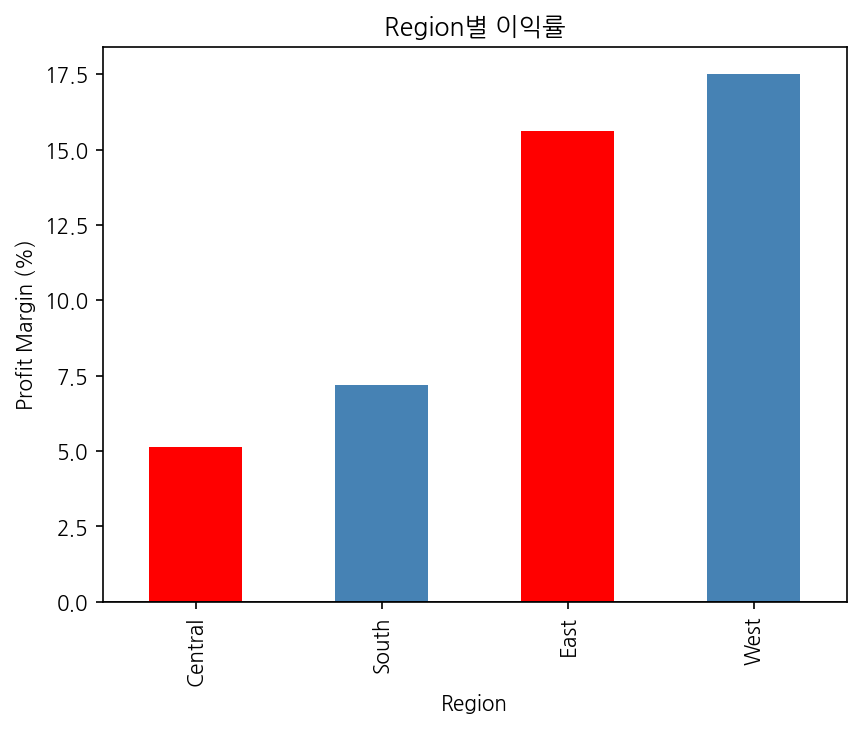
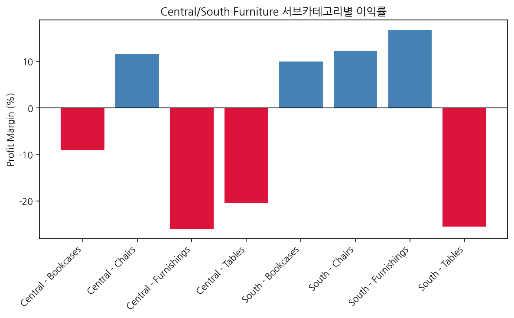
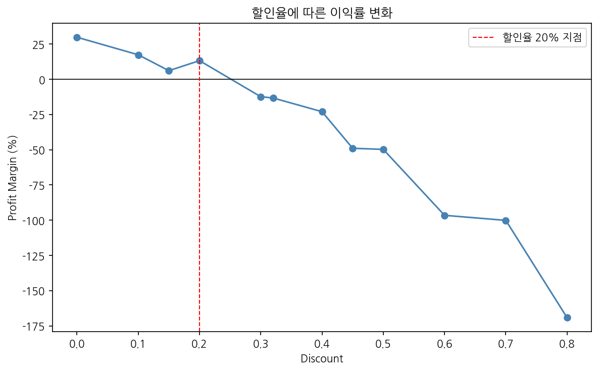

# 지역별 수익성 저하 원인 분석 — Superstore 매출 데이터

> 마케팅팀 요청을 가정하여 지역별 매출과 수익성을 분석한 프로젝트입니다. SQL을 이용한 데이터 추출부터 수익성 비교, 원인 분석, 가설 검토 및 개선 제안까지 데이터 분석 과정을 단계적으로 수행했습니다.

## 목차

- [프로젝트 배경](#프로젝트-배경)
- [데이터](#데이터)
- [분석 방법론](#분석-방법론)
- [분석 과정 및 결과](#분석-과정-및-결과)
- [결론 및 제안](#결론-및-제안)
- [기술 스택](#기술-스택)
- [한계 및 향후 개선 방향](#한계-및-향후-개선-방향)

---

## 프로젝트 배경

마케팅팀으로부터 다음과 같은 요청을 받았다고 가정하고 분석을 진행했습니다.

> "요즘 지역별로 매출 편차가 있는 것 같습니다. 몇몇 지역은 실적이 계속 안 좋다는 얘기가 나오는데, 어떤 지역이 문제인지, 왜 그런지 데이터로 봐주실 수 있을까요?"

요청에 분석 기준과 비교 기간이 명확하게 제시되지 않았기 때문에, 실제 업무 흐름을 재현하여 분석 기준을 구체화했습니다.

| 항목 | 분석 기준 |
|---|---|
| 분석 기간 | 2017-01-01 ~ 2017-12-30 |
| 주요 지표 | 이익률(Profit Margin) |
| 보조 지표 | 매출(Sales), 이익(Profit) |
| 비교 방식 | 지역(Region) 간 상대 비교 |
| 세부 분석 | 카테고리 및 서브카테고리별 수익성 비교 |

## 데이터

- **데이터 출처**: [Kaggle - Sample Superstore](https://www.kaggle.com/datasets/vivek468/superstore-dataset-final)
- **원본 데이터 규모**: 9,994건
- **분석 데이터 규모**: 2017년 필터링 후 3,312건
- **주요 컬럼**: Region, Category, Sub-Category, Order Date, Sales, Profit, Discount

분석에 필요한 컬럼과 기간을 추출한 뒤, 지역별 수익성을 비교하고 수익성이 낮은 지역의 카테고리 및 서브카테고리를 추가로 분석했습니다.

## 분석 방법론

```text
SQL (SQLite)              →  Pandas                    →  결과 분석
분석 대상 데이터 추출         그룹별 집계 및 지표 계산       수익성 비교 및 가설 검토
```

- **SQL**: 분석에 필요한 컬럼과 기간을 필터링하여 데이터 추출
- **Pandas**: 지역·카테고리·서브카테고리별 매출, 이익, 이익률 집계
- **가설 검토**: 할인율과 이익률의 관계를 집계 결과와 상관계수를 통해 분석
- **개선안 도출**: 수익성이 낮은 지역과 세부 품목을 식별하고 추가 점검이 필요한 항목 제안

## 분석 과정 및 결과

### 1. 지역별 이익률 비교

지역별 이익률을 비교한 결과, Central과 South의 수익성이 East와 West보다 낮게 나타났습니다.

| 지역 | 이익률 |
|---|---:|
| Central | 5.13% |
| South | 7.20% |
| East | 15.60% |
| West | 17.51% |

Central의 이익률은 5.13%, South는 7.20%로 나타났으며, 두 지역 모두 East와 West보다 낮았습니다. 이에 따라 Central과 South를 우선 분석 대상으로 선정하고, 카테고리별 수익성 차이를 추가로 확인했습니다.



### 2. Central·South의 카테고리별 수익성 분석

두 지역의 수익성 저하 원인을 파악하기 위해 카테고리별 이익률을 비교했습니다.

- **Central**: Furniture(-2.88%), Office Supplies(0.15%)의 이익률이 저조하게 나타났습니다.
- **South**: Furniture(-1.53%)에서 손실이 발생했으며, 나머지 카테고리는 이익을 기록했습니다.

분석 결과, 두 지역의 수익성 저하 양상에는 차이가 있었습니다. Central은 Furniture와 Office Supplies를 함께 점검할 필요가 있었으며, South는 손실이 발생한 Furniture를 우선적으로 살펴볼 필요가 있었습니다.

### 3. Furniture 서브카테고리 분석

Furniture의 수익성 저하 원인을 더 구체적으로 파악하기 위해 지역별 서브카테고리 이익률을 비교했습니다.

| 지역 | 서브카테고리 | 이익률 |
|---|---|---:|
| Central | Furnishings | -26.01% |
| South | Tables | -25.51% |
| Central | Tables | -20.42% |
| Central | Bookcases | -9.06% |

Central에서는 Furnishings와 Tables의 이익률이 낮게 나타났으며, South에서는 Tables의 이익률이 낮게 나타났습니다.

특히 **Tables는 Central과 South에서 공통으로 이익률이 낮은 서브카테고리**로 확인되어 우선 점검 대상으로 선정했습니다.

다만 이익률이 가장 낮은 품목이 반드시 총손실액도 가장 큰 것은 아닙니다. 실제 개선 우선순위를 결정할 때는 품목별 매출과 총이익도 함께 확인할 필요가 있습니다.



### 4. Central Office Supplies 서브카테고리 분석

Central의 Office Supplies를 추가로 분석한 결과, 서브카테고리별로 서로 다른 수익성 문제가 나타났습니다.

- **손실 발생**: Binders(-18.75%), Appliances(-3.51%)
- **낮은 수준의 이익**: Supplies(2.67%), Storage(2.99%)

Office Supplies 전체의 낮은 이익률은 모든 서브카테고리에서 동일하게 나타난 현상이 아니었습니다. 따라서 카테고리 전체에 동일한 개선책을 적용하기보다는 품목별 매출, 원가, 할인 조건을 함께 검토할 필요가 있습니다.

### 5. 가설 수립: 할인율이 높을수록 이익률이 낮아지는가?

지역별·카테고리별 수익성을 살펴본 뒤, 할인 정책과 수익성 사이의 관계를 확인하기 위해 다음과 같은 가설을 설정했습니다.

**가설: 할인율이 높을수록 이익률이 낮아질 것입니다.**

이를 검토하기 위해 할인율 구간별 이익률을 집계하고, 할인율과 이익률의 관계를 비교했습니다.

### 6. 할인율과 이익률의 관계 분석

할인율별 이익률 집계 결과, 할인율이 높아질수록 이익률이 낮아지는 패턴이 관찰됐습니다. 분석 데이터에서는 할인율 30% 지점부터 이익률이 마이너스로 전환되는 양상이 나타났습니다.



이러한 결과는 높은 할인율이 수익성 저하와 관련이 있을 가능성을 보여줍니다. 다만 특정 할인율 구간에서 이익률이 음수로 나타났다는 사실만으로 모든 상품에 동일한 손익분기 할인율이 적용된다고 볼 수는 없습니다. 상품별 원가와 판매가격, 판매 구성에 따라 적정 할인율은 달라질 수 있습니다.

### 7. 할인율과 이익률의 상관관계 검토

할인율과 이익률의 관계를 추가로 살펴보기 위해 두 분석 단위의 상관계수를 비교했습니다.

| 분석 대상 | 상관계수 | 해석 |
|---|---:|---|
| 전체 데이터의 할인율 구간별 집계 | -0.96 | 강한 음의 상관관계 |
| Central·South 문제 서브카테고리 8개 그룹 | -0.49 | 음의 상관관계 |

전체 데이터의 할인율 구간별 집계에서는 강한 음의 상관관계가 관찰됐습니다. 반면 Central·South의 문제 서브카테고리 8개 그룹에서는 상관계수가 -0.49로 나타났습니다.

이를 통해 할인율과 이익률 사이에 음의 관계가 있음을 확인했습니다. 다만 **상관관계만으로 할인율이 이익률 저하의 유일한 원인이라고 단정할 수는 없습니다.** 상품 구성, 매입원가, 판매량 등 다른 요인도 영향을 줄 수 있으므로 추가 분석이 필요합니다.

## 결론 및 제안

### 1. 할인 정책 점검

분석 데이터에서 할인율이 높아질수록 이익률이 낮아지는 패턴이 관찰됐습니다. 따라서 고할인 상품과 할인율 구간별 수익성을 우선적으로 점검할 필요가 있습니다.

할인율 상한을 20~25% 수준으로 설정하는 방안을 초기 검토안으로 제안합니다. 다만 이를 전사 공통 기준으로 바로 적용하기보다는 상품별 원가와 판매량을 반영한 시뮬레이션을 통해 적정 수준을 검증해야 합니다.

### 2. 상품별 원가 및 할인 조건 점검

Central의 Binders와 Appliances는 이익률이 음수로 나타났지만, 할인율만으로 손실 원인을 단정하기는 어렵습니다.

구매팀과 협의하여 공급업체별 매입원가, 판매가격, 할인 조건을 함께 검토하고 손실이 발생하는 구체적인 원인을 확인할 필요가 있습니다.

### 3. Tables 서브카테고리 우선 점검

Central과 South 모두에서 Tables의 이익률이 낮게 나타났습니다. 이에 따라 두 지역의 Tables를 공통 점검 대상으로 선정하고, 지역별 매출·총이익·할인율을 비교하여 개선 우선순위를 결정할 것을 제안합니다.

최종 우선순위는 이익률뿐 아니라 실제 총손실액과 개선 가능성까지 고려해 결정해야 합니다.

## 기술 스택

`Python` `Pandas` `SQLite` `Matplotlib` `SQL`

## 한계 및 향후 개선 방향

- **표본 수의 한계**: Central·South 문제 서브카테고리의 상관관계 분석은 8개 그룹을 대상으로 하므로 표본이 적습니다. 더 많은 관측치를 활용한 추가 검증이 필요합니다.
- **인과관계 검증의 한계**: 할인율과 이익률의 상관관계만으로 인과관계를 확정할 수 없습니다. 상품별 원가, 판매량, 고객 세그먼트 등 다른 변수의 영향도 검토해야 합니다.
- **추가 변수 분석**: 배송 방식(Ship Mode), 고객 세그먼트(Segment), 상품별 매입원가 등 추가 변수를 분석하지 않았습니다. 향후 해당 변수를 포함하여 수익성 저하 원인을 더 구체적으로 분석할 수 있습니다.
- **시각화 확장**: 현재는 정적 분석 결과물이며, 향후 Tableau 또는 Power BI를 활용한 인터랙티브 대시보드로 확장할 계획입니다.
